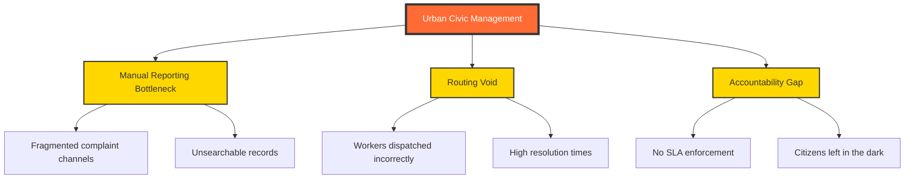
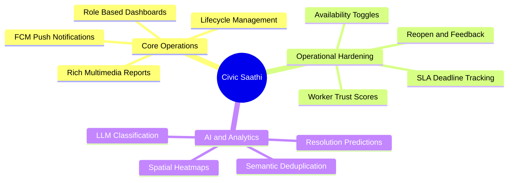
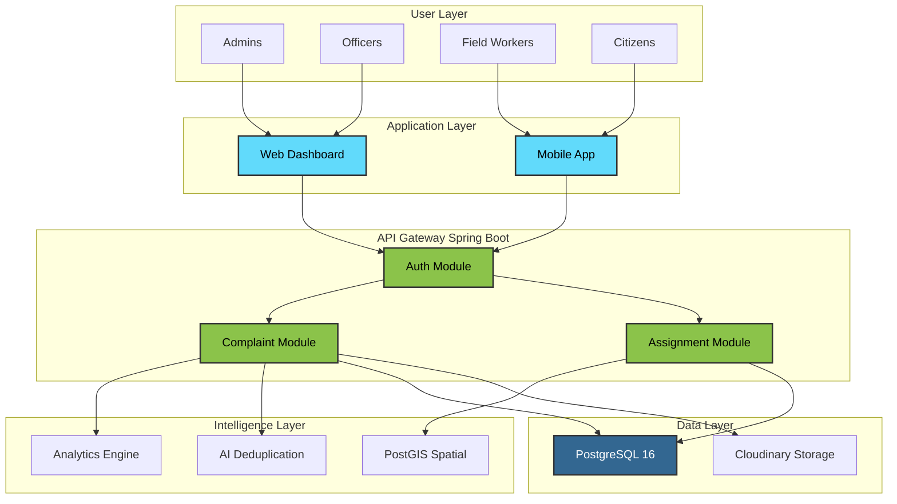
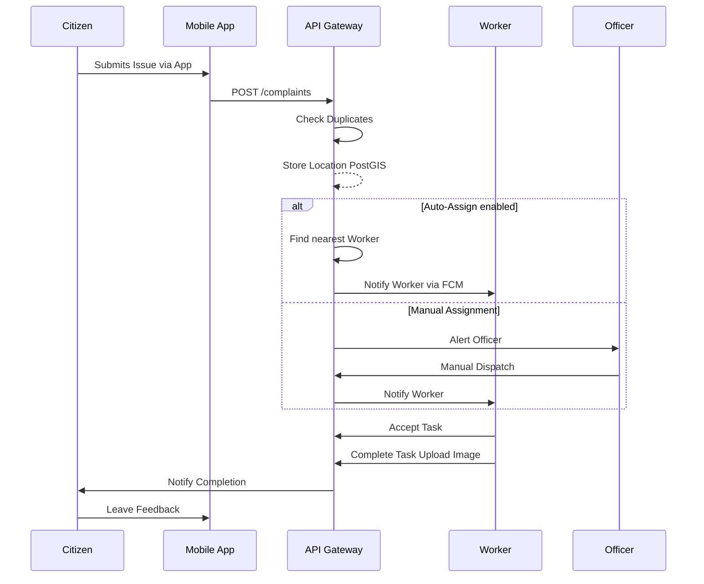

<div align="center">

```ascii
╔═══════════════════════════════════════════════════════════════════════════════════╗
║                                                                                   ║
║   ██████╗██╗██╗   ██╗██╗ ██████╗    ███████╗ █████╗  █████╗ ████████╗██╗  ██╗██╗  ║
║  ██╔════╝██║██║   ██║██║██╔════╝    ██╔════╝██╔══██╗██╔══██╗╚══██╔══╝██║  ██║██║  ║
║  ██║     ██║██║   ██║██║██║         ███████╗███████║███████║   ██║   ███████║██║  ║
║  ██║     ██║╚██╗ ██╔╝██║██║         ╚════██║██╔══██║██╔══██║   ██║   ██╔══██║██║  ║
║  ╚██████╗██║ ╚████╔╝ ██║╚██████╗    ███████║██║  ██║██║  ██║   ██║   ██║  ██║██║  ║
║   ╚═════╝╚═╝  ╚═══╝  ╚═╝ ╚═════╝    ╚══════╝╚═╝  ╚═╝╚═╝  ╚═╝   ╚═╝   ╚═╝  ╚═╝╚═╝  ║
║                                                                                   ║
║                         CIVIC SAATHI • EMPOWERING CITIZENS                        ║
║                                                                                   ║
╚═══════════════════════════════════════════════════════════════════════════════════╝
```

### *A Comprehensive Role-Based Civic Issue Reporting and Resolution Platform*

[](https://spring.io/projects/spring-boot)
[](https://reactnative.dev/)
[](https://reactjs.org/)
[](https://www.postgresql.org/)
[](https://postgis.net/)
[](https://www.docker.com/)

---

### 🌟 *"Bridging the gap between citizens, municipal field workers, and department officers"*

---

</div>

## 📖 Table of Contents
- [🎯 Project Vision](#-project-vision)
- [⚡ The Problem We Solve](#-the-problem-we-solve)
- [🚀 Key Features](#-key-features)
- [🏗️ System Architecture](#️-system-architecture)
- [🔄 Technical Workflows](#-technical-workflows)
- [💻 Tech Stack](#-tech-stack)
- [📸 Screenshots](#-screenshots)
- [🛠️ Getting Started](#️-getting-started)
- [⚙️ Environment Variables](#️-environment-variables)
- [🌐 API Reference](#-api-reference)
- [🗄️ Database Schema](#-database-schema)
- [🤝 Contributing](#-contributing)
- [🏆 Contributors](#-contributors)

---

<div align="center">

## 🎯 PROJECT VISION

**"Transforming Civic Issues from Unresolved Complaints into Transparent Actions"**

</div>

**Civic Saathi** is an advanced, modular monolith platform aimed at solving urban management challenges. Using cutting-edge technologies including **Spring Boot 3.3.6**, **PostGIS** for precise spatial data, **React Native**, and **React**, it enables real-time issue reporting, intelligent routing, and strict SLA enforcement.

<table>
<tr>
<td align="center" width="25%">

<br><b>15+</b>
<br><sub>Civic Categories</sub>
</td>
<td align="center" width="25%">

<br><b>PostGIS</b>
<br><sub>Spatial Auto-Routing</sub>
</td>
<td align="center" width="25%">

<br><b>Real-Time</b>
<br><sub>SLA Tracking</sub>
</td>
<td align="center" width="25%">

<br><b>4 Roles</b>
<br><sub>RBAC Ecosystem</sub>
</td>
</tr>
</table>

---

## ⚡ THE PROBLEM WE SOLVE

### 📉 The Trilemma of Inefficiency



---

## 🚀 KEY FEATURES

<div align="center">

### 🌟 Three Pillars of Innovation

</div>



### 🎯 Core Capabilities

<table>
<tr>
<td width="33%" valign="top">

#### 📱 **Citizen Empowerment**
- 📝 **Rich Media**: Image and Voice Note integration
- 🧠 **Auto-Location**: Precise GPS capture
- 🌐 **Transparency**: Live status tracking
- ⚡ **Feedback Loop**: Rate workers and reopen issues

</td>
<td width="33%" valign="top">

#### 🛰️ **Geospatial Intelligence**
- 🌍 **PostGIS**: Radius-based task assignment
- 📊 **Heatmaps**: Ward-level insights
- 🗺️ **Proximity Sorting**: Nearest tasks for workers
- ⏰ **Geofencing**: Task boundary validation

</td>
<td width="33%" valign="top">

#### 📍 **Automated Enforcement**
- 🎯 **Algorithmic Routing**: Match category + location
- 📱 **SLA Management**: Auto-escalation of delays
- 🔒 **Duplicate Detection**: Prevent redundant dispatch
- 🔄 **Analytics Engine**: Macro-level admin charts

</td>
</tr>
</table>

---

## 🏗️ SYSTEM ARCHITECTURE

<div align="center">

### 🎨 High-Level Architecture

</div>



### 🔄 Technical Workflows

### 📝 Complaint Lifecycle Flow



---

## 💻 TECH STACK

<div align="center">

### 🎨 Frontend Technologies

</div>

<table>
<tr>
<td align="center" width="25%">

<br><b>React 18</b>
<br><sub>Web UI Framework</sub>
</td>
<td align="center" width="25%">

<br><b>TypeScript</b>
<br><sub>Type Safety</sub>
</td>
<td align="center" width="25%">

<br><b>React Native</b>
<br><sub>Mobile Apps</sub>
</td>
<td align="center" width="25%">

<br><b>Zustand</b>
<br><sub>State Management</sub>
</td>
</tr>
</table>

<div align="center">

### ⚙️ Backend Technologies

</div>

<table>
<tr>
<td align="center" width="25%">

<br><b>Java 17</b>
<br><sub>Core Language</sub>
</td>
<td align="center" width="25%">

<br><b>Spring Boot</b>
<br><sub>API Framework</sub>
</td>
<td align="center" width="25%">

<br><b>PostgreSQL</b>
<br><sub>Database</sub>
</td>
<td align="center" width="25%">

<br><b>PostGIS</b>
<br><sub>Spatial Extension</sub>
</td>
</tr>
</table>

<div align="center">

### 🔧 DevOps & Infrastructure

</div>

<table>
<tr>
<td align="center" width="33%">

<br><b>Docker</b>
<br><sub>Containerization</sub>
</td>
<td align="center" width="33%">

<br><b>Cloudinary</b>
<br><sub>Asset Storage</sub>
</td>
<td align="center" width="33%">

<br><b>Firebase</b>
<br><sub>Push Notifications</sub>
</td>
</tr>
</table>

---

## 📸 SCREENSHOTS

| **Citizen Dashboard** | **Report an Issue** | **Worker Map View** |
|:---:|:---:|:---:|
|  |  |  |

| **Admin Analytics Dashboard** | **Task Assignment View** |
|:---:|:---:|
|  |  |

---

## 🛠️ GETTING STARTED

### Prerequisites
Make sure you have the following installed on your machine:
- **Java 17 (JDK)**
- **Node.js 18+** & npm 9+
- **Docker Desktop** (highly recommended for Postgres/PostGIS)
- **Git**

### Installation & Setup

1. **Clone the Repository**
   ```bash
   git clone https://github.com/divyansh357/Civic-Saathi.git
   cd Civic-Saathi
   ```

2. **Configure Environment Variables**
   The project requires a root `.env` file and a separate `.env` file for the mobile app.
   ```bash
   # Root environment (Used by Backend, Dashboard, and Docker)
   cp .env.example .env
   
   # Mobile App environment (Expo requires its own env file)
   cd mobile-app && cp .env.example .env && cd ..
   ```

3. **Start the Database Infrastructure (Docker)**
   This spins up PostgreSQL along with the vital PostGIS and pgvector extensions.
   ```bash
   cd infra
   docker compose up -d postgres
   ```
   *Note: The `infra/docker/init.sql` script runs automatically to seed the extensions.*

4. **Launch the Backend API**
   ```bash
   cd backend
   # Linux/Mac
   ./mvnw clean spring-boot:run
   # Windows
   .\mvnw.cmd clean spring-boot:run
   ```
   *Verify it's running by checking the health endpoint: `http://localhost:8080/actuator/health`*

5. **Start the Web Dashboard**
   ```bash
   cd web-dashboard
   npm install
   npm run dev
   ```
   *Dashboard will be accessible at `http://localhost:5173`*

6. **Start the Mobile App (Expo)**
   ```bash
   cd mobile-app
   npm install 
   npm run start
   ```
   *Press `a` for Android Emulator, `i` for iOS simulator, or scan the QR code using the Expo Go app on your physical device.*

---

## 🛠️ USEFUL COMMANDS & TROUBLESHOOTING

### Common Commands
- **Run Backend Tests:** `cd backend && ./mvnw test`
- **Build Backend Jar:** `cd backend && ./mvnw clean package`
- **Dashboard Typecheck:** `cd web-dashboard && npm run typecheck`
- **Full Docker Stack (Backend + DB):** `cd infra && docker compose up --build`

### Troubleshooting Checklist
- ❌ **Port Conflict (5432/8080/5173):** Check if another Postgres or Tomcat instance is running on your host machine.
- ❌ **Mobile App cannot connect to API:** If using a physical phone, replace `localhost` in `EXPO_PUBLIC_API_URL` with your computer's local Wi-Fi IP address (e.g., `192.168.1.15`).
- ❌ **Backend fails to connect to DB:** Ensure the Docker container is healthy (`docker ps`) and credentials in `.env` match `docker-compose.yml`.

---

## ⚙️ ENVIRONMENT VARIABLES

| Variable | Location | Description | Default / Example |
|---|---|---|---|
| `SERVER_PORT` | Root `.env` | Port for Spring Boot backend | `8080` |
| `DB_URL` | Root `.env` | PostgreSQL connection URL | `jdbc:postgresql://localhost:5432/Civic` |
| `DB_USERNAME` | Root `.env` | Postgres username | `postgres` |
| `DB_PASSWORD` | Root `.env` | Postgres password | `root` |
| `JPA_DDL_AUTO`| Root `.env` | Hibernate schema management | `update` |
| `VITE_API_URL` | Root `.env` | Web Dashboard Base API URL | `http://localhost:8080/api/v1` |
| `EXPO_PUBLIC_API_URL`| `mobile-app/.env` | Mobile App Base API URL | `http://localhost:8080/api/v1` |

---

## 🌐 API REFERENCE

**Base API Path:** `http://localhost:8080/api/v1`
*(Note: All endpoints except `/auth/**` require a valid JWT `Authorization: Bearer <token>` header)*

### 🔐 Authentication (`/auth`)
| Endpoint | Method | Description |
|---|:---:|---|
| `/auth/signup` | `POST` | Register a new user (Citizen, Worker, Officer, Admin) |
| `/auth/login` | `POST` | Authenticate and retrieve JWT access token |
| `/auth/profile` | `GET` | Retrieve the currently authenticated user's profile and RBAC roles |

### 📝 Complaints (`/complaints`)
| Endpoint | Method | Description |
|---|:---:|---|
| `/complaints` | `POST` | Submit a new civic issue (Supports multipart form data for image/voice uploads) |
| `/complaints` | `GET` | Retrieve a paginated list of complaints (Supports filtering by status, ward, category) |
| `/complaints/{id}` | `GET` | Fetch detailed information, timeline, and audit history of a specific complaint |
| `/complaints/{id}/status` | `PATCH` | Transition the lifecycle state (e.g., `OPEN` → `IN_PROGRESS` → `RESOLVED`) |

### 📍 Assignments & Routing (`/assignments`)
| Endpoint | Method | Description |
|---|:---:|---|
| `/assignments/auto-assign` | `POST` | Trigger PostGIS proximity routing algorithm to dispatch nearest available worker |
| `/assignments/worker/tasks`| `GET` | Fetch active geographic tasks assigned to the authenticated field worker |
| `/assignments/{id}/accept` | `POST` | Worker acknowledges and accepts an assigned task to start the SLA timer |

### 📊 Analytics & Admin (`/analytics`)
| Endpoint | Method | Description |
|---|:---:|---|
| `/analytics/heatmap` | `GET` | Fetch aggregated `GEOGRAPHY` spatial points for rendering UI heatmaps |
| `/analytics/department-sla`| `GET` | View resolution time metrics, completion rates, and SLA breaches per department |

> **Interactive Docs:** A complete OpenAPI / Swagger UI specification is automatically generated when running the backend locally. Visit `http://localhost:8080/swagger-ui.html` to interactively test all endpoints.

---

## 🗄️ DATABASE SCHEMA

The platform uses **PostgreSQL 16** with **PostGIS 3.4**:
- **Geography Hierarchy**: `City` → `Zone` → `Ward` mapping.
- **RBAC**: Many-to-Many User/Roles architecture.
- **Spatial Features**: `GEOGRAPHY(Point, 4326)` for radius routing.
- **Audit Logging**: `ComplaintStatusHistory`, `ComplaintVersion`, ensuring compliance.

---

## 🤝 CONTRIBUTING

We welcome contributions from the community!

1. **Fork the Repository**
2. **Create a Feature Branch** (`git checkout -b feature/AmazingFeature`)
3. **Commit Your Changes** (`git commit -m 'Add AmazingFeature'`)
4. **Push to the Branch** (`git push origin feature/AmazingFeature`)
5. **Open a Pull Request**

---

## 🏆 CONTRIBUTORS

A massive thank you to our team for making urban governance smarter!

| Name | Role | GitHub Profile |
|:---|:---|:---|
| **Harshit Goud** | Lead Developer & Architect | [@harshitgour1](https://github.com/harshitgour1) |
| **Divyansh Gupta** | Lead Developer & Architect | [@divyansh357](https://github.com/divyansh357) |
| **Asmi Gupta** | UI/UX Designer & Front-end Developer | [@asmi1074](https://github.com/asmi1074) |
| **Kavin Raj Singh** | Documentation & Planning | [@2wizArd9](https://github.com/2wizard9) |

---

<div align="center">
  <b>Built with ❤️ for Civic Governance</b>
</div>
