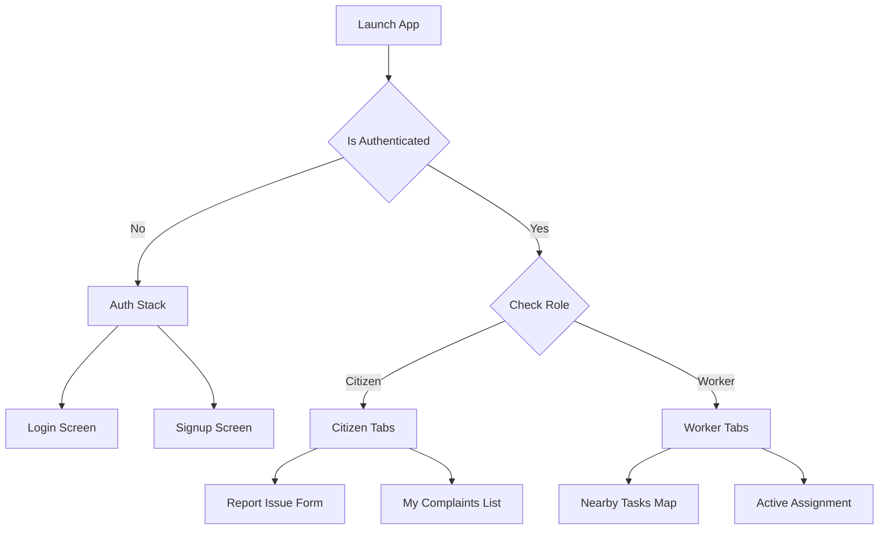

# 📱 Civic Saathi - Mobile App

The unified mobile application serving both **Citizens** and **Field Workers**, built natively with React Native and Expo. 

## 🛠️ Tech Stack
- **React Native 0.81.5**
- **Expo 54** (Managed workflow)
- **TypeScript**
- **Zustand** (Global state management)
- **Axios** (API networking)
- **Expo Location** (GPS tracking)
- **Expo Image Picker / Camera** (Media capture)
- **Expo AV** (Voice notes)

## 📱 Navigation Flow

This app uses a unified authentication barrier, dynamically routing users based on their Spring Boot RBAC roles upon successful login.



## 📂 Directory Structure
- `src/screens/`: Main application views mapped to navigation routes.
- `src/navigation/`: React Navigation stack and bottom-tab configurations.
- `src/components/`: Reusable native UI components (Cards, Buttons, Inputs).
- `src/store/`: Zustand state management (Auth caching, Tasks, Location cache).
- `src/services/`: API abstractions and device hardware integrations (Camera, GPS, Media upload).

## 🚀 Key Features

### For Citizens
- **Report Civic Issues**: Capture high-accuracy GPS coordinates along with pictures and voice descriptions of urban issues (potholes, garbage, etc.).
- **Live Tracking**: Follow the 15-stage lifecycle of complaints until resolution.
- **Feedback Loop**: Provide Star Ratings and comments once the task is marked completed.

### For Field Workers
- **Proximity Task Fetching**: View a sorted list of tasks closest to the worker's current location via PostGIS matching.
- **On-Site Management**: Accept tasks, navigate to the site, and capture completion proof via camera.
- **Push Notifications**: Receive instant FCM updates when assigned a new issue.

## ⚙️ Environment Configuration

Unlike the web dashboard, Expo strictly requires its environment variables to be within the mobile app's own directory.

Create a `.env` file inside this `mobile-app` directory:

| Variable | Description | Default |
|---|---|---|
| `EXPO_PUBLIC_API_URL` | Base URL for the Spring Boot API | `http://localhost:8080/api/v1` |
| `EXPO_PUBLIC_API_TIMEOUT` | Axios request timeout in ms | `30000` |

> ⚠️ **IMPORTANT**: If running on a physical device, `localhost` will not work. Replace `localhost` with your computer's local Wi-Fi IP address (e.g., `http://192.168.1.15:8080/api/v1`) before starting Expo.

## 🚦 Getting Started

### Prerequisites
- Node.js 18+
- Expo CLI (`npm install -g expo-cli`)
- Android Studio / Xcode OR the **Expo Go app** installed on your physical mobile device.

### Run Locally
```bash
npm install
npm run start
```
1. Scan the QR code printed in the terminal using your Expo Go app to test directly on your phone. 
2. Press `a` in the terminal to launch on an Android emulator.
3. Press `i` to launch on an iOS simulator (macOS only).

### Troubleshooting
- ❌ **Network Error / Connection Refused**: Your physical phone cannot resolve `localhost` to hit the backend. Update `.env` to your PC's IP address and restart the bundler.
- ❌ **Stale Cache Issues**: If environment variables aren't updating or the app behaves weirdly after a package update, start Expo with the cache cleared: 
  ```bash
  npm run start -- -c
  ```
