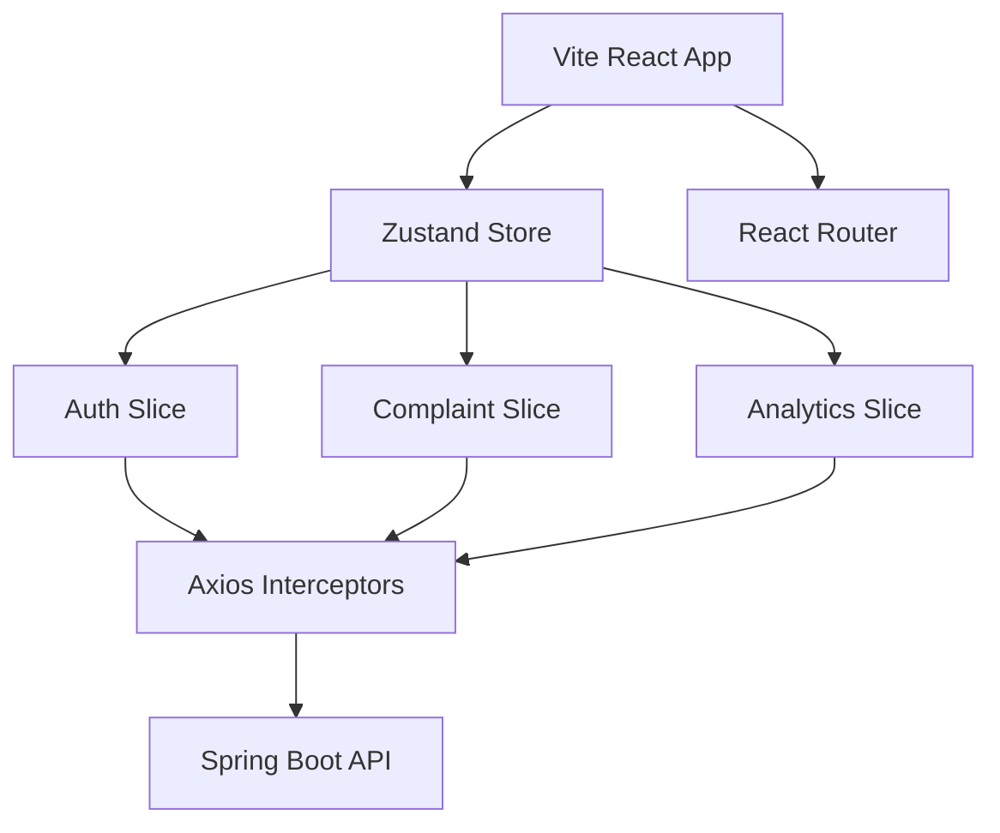

# 🌐 Civic Saathi - Web Dashboard

The administrative and officer-facing web portal for monitoring city-wide civic issues, managing field workers, and analyzing geographic complaint trends.

## 🛠️ Tech Stack
- **React 18**
- **Vite** (Lightning fast build tool)
- **TypeScript** (Strict type checking)
- **Zustand** (State management)
- **Recharts** (Interactive analytics charts)
- **Tailwind CSS** (Utility-first styling)

## 📊 Application Architecture

The dashboard relies on a decoupled state management approach using Zustand, keeping UI components lightweight and mapping directly to the backend domain modules.



## 📂 Directory Structure
- `src/components/`: Reusable UI elements (buttons, modals, tables, KPI cards).
- `src/pages/`: Main route views (Dashboard, Complaints Kanban, Analytics, User Management).
- `src/store/`: Zustand state slices defining global stores.
- `src/api/`: Axios instances, request/response interceptors, and API call definitions.
- `src/utils/`: Pure helper functions (date formatting, SLA deadline calculation, mapping).

## 🚀 Key Features

### For Officers
- **Manual Dispatching**: Override the automated algorithmic routing and assign complex tasks to specific workers.
- **SLA Tracking**: Monitor overdue tasks and respond to automatic escalations.
- **Kanban View**: Visual board to track complaints across `Submitted`, `In Progress`, and `Resolved` states.

### For Admins
- **Global Analytics**: View city-wide aggregated data, completion rates, and average resolution times.
- **Geospatial Heatmaps**: Identify clustered civic issues down to the Ward and Zone levels.
- **Department Rankings**: Monitor which departments are adhering to SLAs.

## ⚙️ Environment Configuration

The web dashboard automatically reads variables from the `.env` file located in the *root* of the repository (thanks to Vite's `envDir` config).

| Variable | Description | Required | Default |
|---|---|:---:|---|
| `VITE_API_URL` | Base URL for the Spring Boot Backend | ✅ | `http://localhost:8080/api/v1` |
| `VITE_API_TIMEOUT` | Axios request timeout (ms) | ❌ | `30000` |

## 🚦 Getting Started

### Prerequisites
- Node.js 18+

### Run Locally
1. Ensure the root `.env` is configured properly.
2. Install dependencies and start the dev server:
```bash
npm install
npm run dev
```

Access the dashboard at `http://localhost:5173`.

### Useful Commands
- **Typecheck**: `npm run typecheck` (Runs the TypeScript compiler to catch errors without emitting compiled files).
- **Production Build**: `npm run build` (Generates optimized static assets in the `dist/` folder).
- **Preview Build**: `npm run preview` (Locally serves the `dist/` folder to test production behavior).
